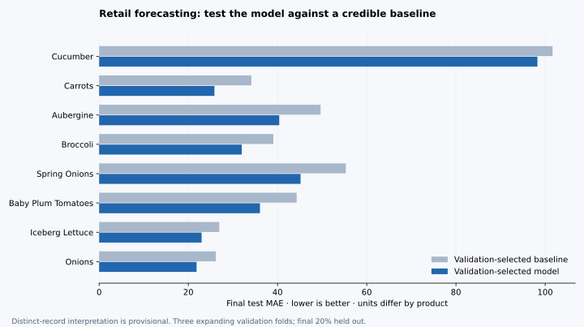

# Retail Decision Lab

**Demand forecasting and perishable inventory decisions, with reproducible evidence.**

A portfolio extension of an Operations & Decisions coursework project. The question is practical: can a sales forecast improve replenishment decisions when extra stock can expire? This repository evaluates three forecasting methods, connects their predictions to a daily inventory policy, and makes the data assumptions inspectable.

[Results and limitations](reports/RESULTS.md) · [Method](docs/METHODOLOGY.md) · [Data provenance](docs/DATA.md) · [Interview walkthrough](docs/WALKTHROUGH.md)



## What you can inspect

| Area | Implemented evidence |
| --- | --- |
| Data quality | Audit of repeated sales records, conflicting discount metadata and missing dates; switch between distinct-record and original row-summing assumptions |
| Forecasting | Yesterday, same day last week, and Random Forest; three expanding validation windows; final chronological holdout |
| Decision analysis | FIFO stock, lead-time deliveries, expiration, lost sales, validation-calibrated buffers and adjustable scenario costs |
| Product interface | Streamlit dashboard with product comparisons, stock traces, price–sales summaries and CSV downloads |
| Reproducibility | Shared Python modules, pinned direct dependencies, input hash, saved metrics, regression tests and a GitHub Actions workflow |

**Important data qualification:** the supplied file has 204,135 rows but 72,452 distinct `C520_*` sales records. Some records appear under several article identifiers. The default counts identical sales records once, while retaining distinct records on the same date. This is a provisional interpretation of a suspected join expansion—not a source-verified correction. Use the sensitivity switch to inspect the original assumption. Source attribution and redistribution permission remain unverified; see [the data note](docs/DATA.md).

## Run locally

Use **Python 3.12**. No API key, database, paid model or cloud account is required.

```bash
git clone https://github.com/sudhanshudubey/Operation_decision.git
cd Operation_decision
python3.12 -m venv .venv
source .venv/bin/activate
python -m pip install -r requirements.txt
python -m streamlit run app.py
```

On Windows, activate the environment with `.venv\Scripts\activate`. Open the local URL printed by Streamlit. The first load fits the evaluation models; subsequent product changes reuse the cached analysis. The file is resolved relative to the project, not your shell's working directory.

## Reproduce the evidence

```bash
python -m scripts.evaluate
python -m unittest discover -s tests -v
python -m scripts.evaluate --check
```

The first command writes the results report, compact CSV evidence, input manifest and chart. It also creates a local predictions CSV that is excluded from version control. `--check` recomputes the experiment and compares all seven committed evidence tables within numerical tolerance. Tests cover temporal leakage, sales grain, forecast recursion, missing observations, inventory conservation, delivery timing, expiration and dashboard interactions.

An optional [analysis notebook](notebooks/retail_decision_analysis.ipynb) uses the same modules. Open it in a Jupyter-enabled editor with the project interpreter. It requires a notebook kernel in addition to the dashboard dependencies.

## Read the result correctly

The initial ten products are chosen using sales **before the first validation window**. Products without enough observations are listed as exclusions, not replaced. A model and a simple baseline are selected per product using validation MAE, then refit before the final test. Test metrics include MAE, WAPE, seasonal MASE and signed bias. Missing observations are never silently changed into zero sales.

The inventory experiment uses forecasts over lead time plus one review day. Its 90% and 95% labels describe **validation error-buffer quantiles**, not guaranteed service levels. Actual fill rate, lost sales, spoilage and scenario cost are measured on a disclosed consecutive test window. A model with lower forecast error can still produce a worse inventory outcome.

This is a **historical decision-support prototype**. It does not establish live forecasting performance, causal price elasticity, optimal service targets, or actual cost/waste reduction. The data cover one store from 2017-12-26 to 2019-12-24.

## Repository guide

```text
app.py                         Streamlit dashboard
retail/data.py                 Validation, sales-grain audit and daily observations
retail/forecast.py             Features, chronological evaluation and recursive forecasts
retail/inventory.py            Validation buffers and daily FIFO simulation
scripts/evaluate.py            Reproduction command and report generation
tests/                         Analytical regression and dashboard checks
reports/                       Committed metrics, assumptions and findings
notebooks/                     Shared-module analysis and archived coursework
docs/                          Method, data qualification and presentation walkthrough
```

The [original coursework notebook](notebooks/archive/original_coursework.ipynb) is preserved for context. Its outputs and recommendations are superseded by the revised experiment; it is not the runnable entry point. The empty notebook and redundant dataset ZIP have been removed.

## Ownership and next steps

This public repository is maintained under Sudhanshu Dubey's GitHub account. The archived notebook references a group project; the original team contributions are not documented in the supplied files. Distinguish your own work from team work when presenting it. The portfolio refactor used AI coding assistance; the methodology, assumptions and results should be explained and checked by anyone claiming them as their work.

The highest-value next step is obtaining the original data dictionary and permission record. After confirming the grain, assortment calendar, stockouts, shelf lives and costs, rerun the experiment on a newer store-period. No code or dataset license is inferred or added by this update.
